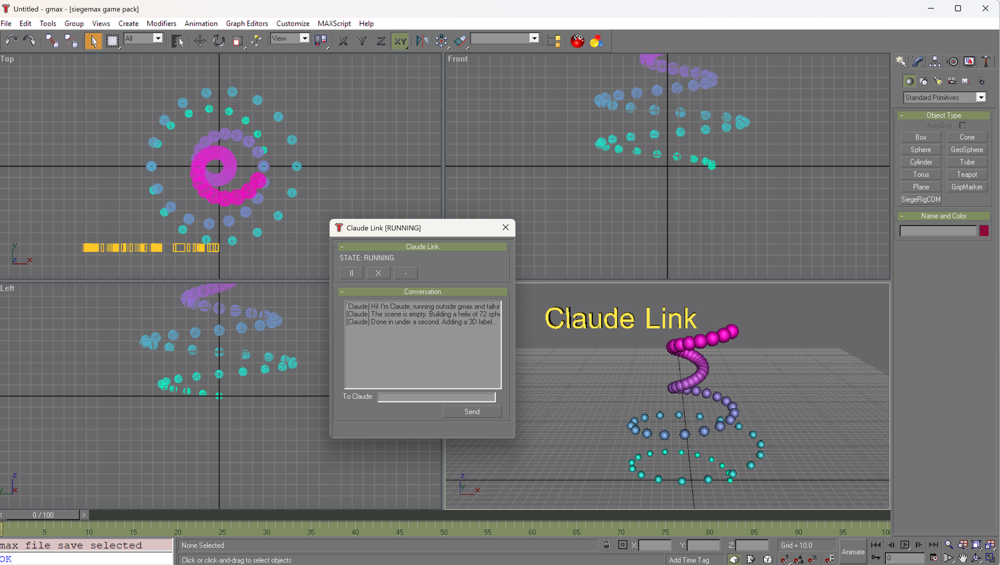

# SiegeMax

Project updating SiegeMax, a model exporter for Dungeon Siege.

## Claude Link: work with an AI assistant *inside* gmax



gmax 1.2 can't be scripted from outside, can't write files, and has no automation hooks.
**Claude Link** is a small dialog plus an outside helper that lets Claude Code (or any script)
run MAXScript in your running gmax, read the answer, watch what you do, and talk to you,
while you keep a hand on the brake.

- **Run code, get answers.** `-Eval` returns the value of an expression, `-Cmd` runs a raw line
  and returns what the Listener prints (including error text).
- **A conversation inside gmax.** The dialog keeps a log of Claude's messages and yours. Type in
  the "To Claude" box; Claude reads it from outside.
- **Pause and Emergency Stop.** The dialog shows `STATE: RUNNING / PAUSED / STOPPED`. The helper
  reads that label before every send and refuses to send anything unless it says RUNNING.
  A missing dialog or an unreadable state blocks too.
- **Follow along.** With the Macro Recorder enabled, everything you do on screen is printed as
  MAXScript in the Listener's upper pane. `-Watch` reads it, so Claude can see your last clicks
  (`Teapot radius:0 ...`, `actionMan.executeAction 0 "40008"`) instead of guessing.
- **Quiet.** It only uses window messages: no focus stealing, no keystrokes into your viewport.
  It works with the full Listener open, closed or minimized, and through the one-line
  mini-listener in the bottom panel.
- **Compact mode.** The `-` button shrinks the dialog to a small strip (`II` pause, `X` stop,
  `+` expand).

### Quick start

```powershell
cd scripts\ClaudeLink
.\gmax_run.ps1 -Open                      # load the dialog into the running gmax
.\gmax_run.ps1 -Say "Hello from outside"  # message in the dialog's log
.\gmax_run.ps1 -Eval '(maxVersion())[1] as string'          # run code, get the value back
.\gmax_run.ps1 -Cmd 'for i = 1 to 3 do format "line %\n" i' # raw line, printed output
.\gmax_run.ps1 -Watch                     # what you just did on screen (macro recorder)
.\gmax_run.ps1 -Status                    # state, listeners, conversation log
```

Requirements: Windows, PowerShell, a running gmax with this gamepack. Press the dialog's `II` or
`X` at any time and the helper stops sending. A script that is already running can only be
interrupted with Esc in gmax. Working notes, the control IDs it relies on, and the gmax quirks
found while building it are in [`scripts/ClaudeLink/MEMORY.md`](scripts/ClaudeLink/MEMORY.md).

## Getting data out of gmax

gmax can't write files either, so data leaves hidden inside the one file it *can* write.
`scripts/Tests/piggyback.ms` packs bytes into the numbers of a generated mesh:

| Route | Carrier | Verified |
|---|---|---|
| ASP export (`PiggybackExport`) | vertex positions in a DSiegeUtils `.asp`, 4 bytes per vertex | byte-exact up to 262,000 bytes per mesh (16-bit corner index limit) |
| Scene file (`PiggybackSave`) | map channel 1 in a `.gmax` scene saved with `saveMaxFile`, 9 bytes per map vertex | byte-exact at 1 MB and 5 MB per call |

Header, checksum, chunking and optional RLE compaction are built in.
`scripts/RigTools/DataOut.ms` wraps it: `DataOutSend`, `DataOutSendString`, `DataOutSendFloats`.
Read the result outside gmax with the extractor:

```
python scripts/Tests/tools/extract_piggyback.py <file.asp | file.gmax | folder> [--text] [-o out.bin]
python scripts/Tests/tools/test_extract_piggyback.py     # self-test, no gmax needed
```

Reading `.gmax` files needs the `olefile` package (`pip install olefile`).

## SiegeRig: a Character Studio equivalent for gmax

An in-progress plan for Biped-style animation (center of mass, IK limbs, posture tools, clips,
baking back to plain Dungeon Siege keys) using only what gmax ships with. See
[`docs/character-studio-plan.md`](docs/character-studio-plan.md) and
[`docs/gmax-capabilities.md`](docs/gmax-capabilities.md).

| Phase | State |
|---|---|
| 0. Data out of gmax (piggyback) | done |
| 0b. Claude Link | done |
| 1. Rig builder, rest pose, Figure Mode | written, not yet run in gmax |
| 2 and later | planned |
